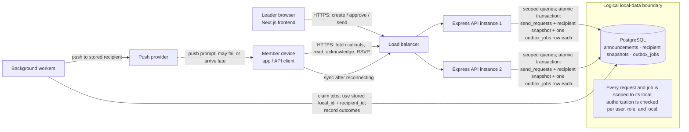

# Requirements

## Confirmed requirements
- Build a callout/announcement feature for union locals. A leader sends to one local, optionally narrowed by work classification; members need to see callouts even if they are offline when sent.
- Enforce local-level data isolation for both members and leadership, and prevent members from using leadership permissions. Union membership/contact data is sensitive.
- Retries and worker restarts must not cause the same member to receive a callout twice. Track each recipient's outcome and actions, rather than only aggregate announcement counts.
- Push is not a reliable measure of receipt: about 5–10% of pushes may silently fail, and members may be offline for hours or days. Leaders need timely visibility into who has read, acknowledged, or plans to attend.
- AI-generated title, body, and push preview (120 characters or fewer) must remain a draft until a human leader approves sending.

## Assumptions
- Unless confirmed otherwise, the send audience is active members of the selected local, optionally filtered by classification; retired and suspended members are excluded.
- No response is required by default. Acknowledgment and an attendance RSVP ("coming" / "can't") are distinct actions; RSVP is needed for the design, but not the required build slice.
- Members can retrieve a sent callout after reconnecting; push is a prompt, not the only way to access it. No delivery-time or availability SLA is specified.
- "No duplicates" applies to both creating duplicate recipient records and sending duplicate notifications on retries. Whether this can be guaranteed at the push-provider boundary depends on provider behavior and needs to be defined.

## Concerns and gaps
- The question about members outside a local seeing apprentices' contact information may indicate an existing exposure, not just a future requirement. Treat this as a potential incident to investigate and contain before relying on a new feature's access controls.
- A unique recipient record alone does not establish that a member was notified, received the callout, read it, acknowledged it, or RSVP'd. Those states must not be conflated, especially when push can fail silently.
- "Immediately" and "before I leave the hall" have no measurable timing target; no RSVP deadline, edit policy, or rule for late audience changes is given.

## Open questions for Denise
1. Who is eligible for a callout: active members only, and how should classification changes or membership changes after sending affect it? Assumed active members at send time.
2. What does "immediately" mean, and which notification states should leadership see as sent or delivered when a push fails or a member is offline? Assumed send begins promptly, with recipient-level progress and later access.
3. Should attendance responses be optional or required, by what deadline, and may members change them? Assumed optional unless a callout explicitly requests an RSVP.

# Part A: The design

## 1. Data model

- **`locals`** stores each union local. **`users`** stores authentication identity only; it has no global member/leader role. **`local_members`** stores a user's local-specific member profile, including name, contact details, `classification_id`, and active/retired/suspended status. **`local_leaders`** grants leadership access for a specific local. Both local-access tables use `(local_id, user_id)` as a primary or unique key, with foreign keys to `locals` and `users`. A user can have different or multiple local relationships without those permissions becoming global.
- **`classifications`** stores work classifications scoped to a local, with a unique `(local_id, id)` key. `local_members` references it using `(local_id, classification_id)`, preventing a profile from using another local's classification.
- **`local_members`** has its own UUID `id`, a foreign key `user_id` to `users`, and unique `(local_id, user_id)` and `(local_id, id)` keys. Thus recipient `member_id` always means `local_members.id`, never the authentication `users.id`.
- **`announcements`** belongs to a local and stores its author, title, body, push preview, acknowledgement requirement, draft/approval/send state, and relevant timestamps. Its author is constrained by a composite foreign key `(local_id, author_user_id)` to `local_leaders`; approval, when recorded, is likewise tied to a leader in that local. Give announcements a unique `(local_id, id)` key for downstream composite references.
- **`announcement_recipients`** has UUID `id`, `local_id`, `announcement_id`, and `member_id`, with `(announcement_id, member_id)` unique and `(local_id, id)` unique. Composite foreign keys `(local_id, announcement_id)` and `(local_id, member_id)` reference the corresponding announcement and `local_members` keys. Materialize these rows from the eligible audience at send time: they are the audience snapshot, not a live query whose membership changes later. Keep push-provider state separate from `read_at`, `acknowledged_at`, and nullable RSVP (`coming` / `can't`); no RSVP is distinct from “can't.”
- **`outbox_jobs`** has UUID `id`, `local_id`, `recipient_id` (the recipient row's `announcement_recipients.id`), status, attempt count, `available_at`, and lease fields such as `lease_until`. A unique `(local_id, recipient_id)` permits one durable job per recipient; a composite foreign key `(local_id, recipient_id)` references `announcement_recipients (local_id, id)`. Workers therefore process the stored local and recipient row, not a client-supplied audience.
- **`send_requests`** records the send idempotency key, local, leader user, announcement, and request hash. A unique `(local_id, leader_user_id, idempotency_key)` scopes key reuse; matching retries return the recorded send, while a different request hash is rejected. Its leader reference is constrained to `(local_id, leader_user_id)` in `local_leaders`.
- **`delivery_attempts`** records each push attempt against its recipient, including attempt time and provider outcome, so retries do not erase history. Use a foreign key to `announcement_recipients`; use a stable provider idempotency key per recipient if the provider supports one.

Use PostgreSQL `CHECK` constraints or enums for finite status/action values and checks for valid approval state/timestamp combinations. Index audience selection on `local_members (local_id, status, classification_id)`, announcement listings on `(local_id, created_at)`, recipient counts/lookups on `(local_id, announcement_id, push_status)` and `(announcement_id, read_at)` / `(announcement_id, acknowledged_at)`, outbox claiming on `(status, available_at)` and lease recovery on `(status, lease_until)`, and attempt history on `(recipient_id, attempted_at)`. Primary keys and unique constraints provide indexes for their keys; add indexes on other foreign-key columns used for joins and lookups.

These constraints reject invalid cross-local references and duplicate recipient records; they do not replace endpoint authorization checks. Likewise, a unique recipient row does not guarantee exactly-once delivery by an external push provider.

## 2. The send path

The authenticated Express endpoint verifies the leader's local permission and that the announcement is approved. The client supplies an idempotency key for the send operation. In one PostgreSQL transaction, the endpoint records the key and request hash in `send_requests`, snapshots eligible members into `announcement_recipients`, creates **one `outbox_jobs` row per recipient**, and marks the announcement as sending. A unique constraint on the scoped key makes a matching repeated request return the original send result rather than create a new audience; reusing the key with a different request hash is rejected. Recipient and outbox uniqueness also prevent duplicate rows/jobs.

After commit, the endpoint returns an accepted/in-progress response; it does not wait for all pushes. Workers claim small batches of ready outbox rows in short transactions using row locks such as `FOR UPDATE SKIP LOCKED`, recording a lease and attempt count. Each job supplies its stored `local_id` and `recipient_id`; workers load and verify that recipient and its member profile in that local, then call the provider outside the transaction and persist the outcome. Transient errors are rescheduled with backoff; permanent errors or exhausted retries are marked failed for review. If a worker crashes, its lease expires and another worker can reclaim the job. A stable provider idempotency key per recipient and announcement prevents repeated provider sends when supported. Without provider support, a crash after provider acceptance but before recording success leaves an ambiguous result: retrying can duplicate a push, while not retrying can lose it. Exactly-once external push delivery cannot be guaranteed in that case.

Push is only a prompt. Members fetch their persisted callouts through the authenticated API and can sync after reconnecting, so being offline or missing a push does not remove access. Provider outcomes remain separate from read, acknowledgment, and RSVP actions.

## 3. The two rules, by design

**Rule 1—local isolation and roles:** Express authenticates requests and derives the user identity from a verified credential, never a client-supplied role. Default-deny authorization checks the user's membership or leadership relationship for the specific local and action on every endpoint; queries are scoped to that local. Composite foreign keys reject cross-local references. PostgreSQL row-level security can add defense in depth if the app role cannot bypass it and each transaction sets its local context safely. Workers use a separate least-privilege identity and validate job local/recipient references. Append audit records for sensitive reads and mutations, including actor, local, action, resource, outcome, and timestamp; exclude credentials and unnecessary personal data.

**Rule 2—duplicate processing:** The transactional send snapshot, unique recipient/job constraints, persisted idempotency key, and leased outbox claims make request retries and worker restarts safe at the database/job level. Provider idempotency is needed to prevent duplicate external pushes across the acceptance/recording crash window; without provider support, exactly-once push delivery cannot be guaranteed.

Test cross-local access by attempting reads and mutations with another local's IDs and by inserting mismatched-local rows directly; verify denial or constraint failure without leaking data. Test member-versus-leader permissions on every protected endpoint. Run concurrent/replayed send requests and worker retry, lease-expiry, and restart tests across multiple workers; assert one recipient and outbox row per eligible member, durable status/attempt history, and provider idempotency-key reuse where supported. Monitor denied cross-local/role checks, database constraint violations, expired or repeatedly retried jobs, and provider failures or acceptance/result discrepancies.

## 4. A diagram

